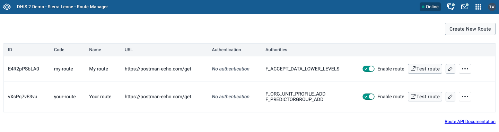
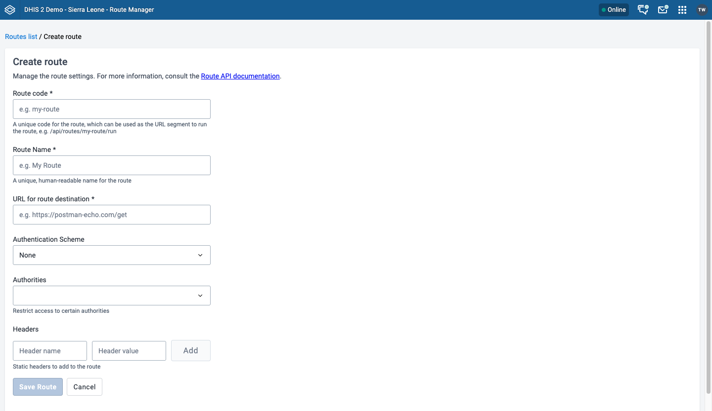
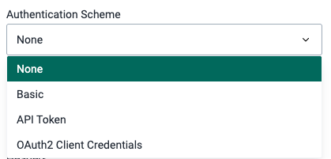
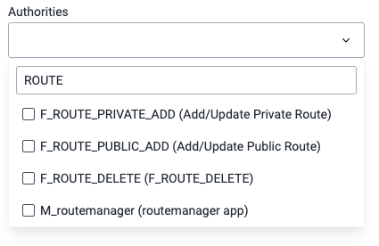
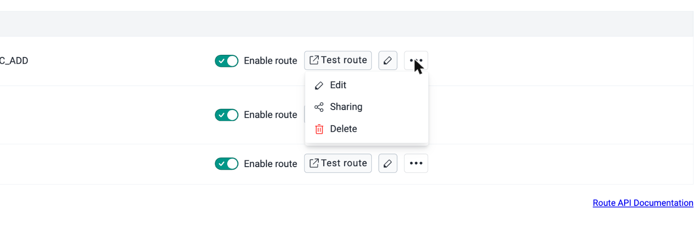
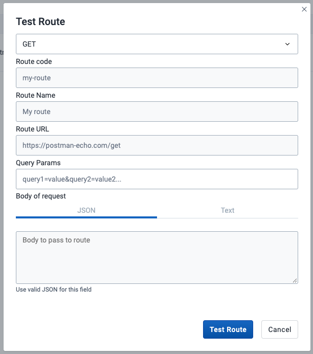
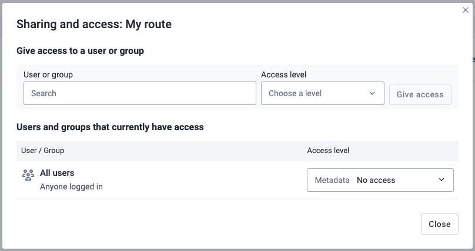

The DHIS2 core team developed the Route Manager app to provide a user interface to manage routes through the [Route API](https://docs.dhis2.org/en/develop/using-the-api/dhis-core-version-master/route.html).

It is an optional app that is available on the [App Hub](https://apps.dhis2.org/app/5dbe9ab8-46bd-411e-b22f-905f08a81d78). You can download it there or install it on an instance through the [App Management app](https://docs.dhis2.org/en/use/user-guides/dhis-core-version-master/maintaining-the-system/installing-applications.html).

## App functionality

The app provides a user interface for the Route API. The API can offer features that the app does not support yet. The app is on continuous release and gets updates to match the API as soon as possible. For these features, you can use the API directly, or contribute to the app on GitHub. Contributions are welcome.

The following is an overview of the functionality that the app supports.

### Required authority

To manage routes, your user role needs the **Add/Update Public Route** authority (`F_ROUTE_PUBLIC_ADD`) or the `ALL` authority. If your user has neither, the app shows a warning on the **Routes list** that you do not have the permissions to configure routes.

### Creating new routes

To create a route, click **Create New Route** at the top right of the **Routes list**. The **Create route** page opens.

The page lets you define the properties of the route. For more details, see the Route API documentation that is linked at the start of this page.

Besides the basic route properties, you can also set an authentication scheme, restrict the authorities that can run the route, and define static headers for the route.

In **Authentication Scheme**, you can choose **None**, **Basic**, **API Token**, or **OAuth2 Client Credentials**. The **OAuth2 Client Credentials** option is available on DHIS2 v42 and later.

The API sometimes offers more than the app does. For example, the API supports the `api-headers` and `api-query-params` authentication modes, and the app does not offer them. The app gets updates to match the API.

### Editing, deleting and disabling existing routes

On the **Routes list**, you can edit a route, delete it, disable it, or change its sharing settings.

To enable or disable a route, use the **Enable route** toggle in the row of the route.

To edit a route, click the pencil icon (**Edit route**). A page similar to the **Create route** page opens, where you can edit the route.

For a disabled route, the app disables the **Test route** and **Edit route** buttons. Enable the route first.

To see more options for a route, click the three dots icon (**more actions**) in the right column of the table. The menu has the options **Edit**, **Sharing**, and **Delete**. If you choose **Delete**, the app asks you to confirm.

### Testing routes

To test a route, click **Test route** in the row of the route on the **Routes list**. A dialog opens where you can use the route to call the upstream server.

In the dialog, you can:

-   Choose the request method: **GET**, **POST**, **PUT**, **DELETE**, **PATCH**, or **JSON-PATCH**.
-   Enter query parameters in **Query Params**. This box is available for **GET** requests on routes that do not use a wildcard.
-   Enter the body of the request in **Body of request**, as JSON or as text. This box is not available for **GET** requests.
-   Enter the rest of the path of the upstream server in **Wildcard path**. This box is available when the URL of the route ends with `**`.

Click **Test Route**. DHIS2 calls the upstream server, and the dialog shows the result.

### Configuring the route metadata sharing

To restrict access to a route for certain users or user groups, click the three dots icon (**more actions**) on the **Routes list** and choose **Sharing**. The **Sharing** dialog opens.

